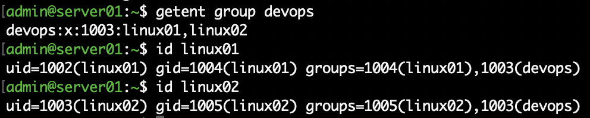
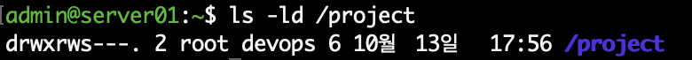
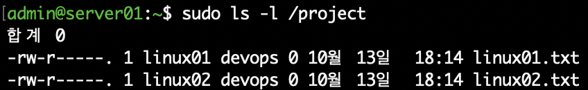
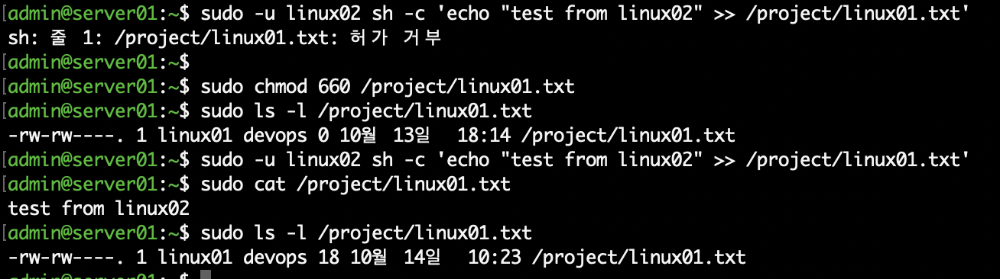

# 02. Linux 사용자 및 권한 관리

## 1. 실습 개요

Rocky Linux 서버에서 사용자와 그룹을 생성하고, SGID를 이용한 공유 디렉터리를 구성하였다.

여러 사용자가 동일한 프로젝트 디렉터리에서 작업하는 환경을 가정하여 그룹 상속과 파일 접근 권한을 검증하였다.

특히 다른 사용자가 생성한 파일의 수정이 거부되는 상황을 확인하고, 그룹 쓰기 권한을 변경하여 문제를 해결하였다.

## 2. 실습 환경

| 항목 | 내용 |
|---|---|
| 가상화 환경 | VMware Fusion |
| 운영체제 | Rocky Linux 10.2 (ARM64) |
| 서버 호스트명 | server01.example.com |
| 관리 계정 | admin |
| 실습 사용자 | linux01, linux02 |
| 공유 그룹 | devops |
| 공유 디렉터리 | /project |

## 3. 사용자 및 그룹 생성

### 3.1 그룹 및 사용자 생성

```bash
sudo groupadd devops

sudo useradd -m linux01
sudo useradd -m linux02
```

### 3.2 보조 그룹 설정

```bash
sudo usermod -aG devops linux01
sudo usermod -aG devops linux02
```

`-aG` 옵션을 사용하여 기존 그룹 정보를 유지하면서 두 사용자를 `devops` 보조 그룹에 추가하였다.

### 3.3 설정 검증

```bash
getent group devops
id linux01
id linux02
```

실제 검증 결과:

```text
devops:x:1003:linux01,linux02

uid=1002(linux01) gid=1004(linux01) groups=1004(linux01),1003(devops)

uid=1003(linux02) gid=1005(linux02) groups=1005(linux02),1003(devops)
```

두 사용자 모두 `devops` 그룹에 정상적으로 소속된 것을 확인하였다.



## 4. SGID 공유 디렉터리 구성

### 4.1 디렉터리 생성 및 권한 설정

```bash
sudo mkdir /project
sudo chown root:devops /project
sudo chmod 2770 /project
```

### 4.2 권한 검증

```bash
ls -ld /project
```

검증 결과:

```text
drwxrws---. 2 root devops 6 /project
```

설정 내용:

- 소유자: root
- 소유 그룹: devops
- 디렉터리 권한: 2770
- SGID 설정: 활성화
- 기타 사용자 접근: 차단

SGID를 설정하여 공유 디렉터리에서 생성되는 파일과 하위 디렉터리가 부모 디렉터리의 그룹을 상속하도록 구성하였다.



## 5. SGID 그룹 상속 검증

서로 다른 사용자 계정으로 파일을 생성하였다.

```bash
sudo -u linux01 touch /project/linux01.txt
sudo -u linux02 touch /project/linux02.txt
```

생성된 파일의 소유권 확인:

```bash
sudo ls -l /project
```

검증 결과:

```text
-rw-r-----. 1 linux01 devops 0 linux01.txt
-rw-r-----. 1 linux02 devops 0 linux02.txt
```

파일 소유자는 각각 다르지만 두 파일 모두 `devops` 그룹을 상속한 것을 확인하였다.



## 6. 파일 접근 권한 문제 및 해결

### 6.1 문제 상황

`linux02` 사용자가 `linux01`이 생성한 파일에 내용을 추가하려고 시도하였다.

```bash
sudo -u linux02 sh -c 'echo "test from linux02" >> /project/linux01.txt'
```

실행 결과:

```text
허가 거부
```

### 6.2 원인 분석

해당 파일의 권한은 `640`이었다.

```text
-rw-r-----. 1 linux01 devops linux01.txt
```

SGID에 의해 그룹은 `devops`로 상속되었으나, 그룹에는 읽기 권한만 부여되어 있었다.

따라서 같은 그룹에 속한 `linux02`도 파일 내용을 수정할 수 없었다.

### 6.3 문제 해결

파일의 그룹 쓰기 권한을 추가하였다.

```bash
sudo chmod 660 /project/linux01.txt
```

권한 변경 결과:

```text
-rw-rw----. 1 linux01 devops linux01.txt
```

### 6.4 해결 결과 검증

```bash
sudo -u linux02 sh -c 'echo "test from linux02" >> /project/linux01.txt'

sudo cat /project/linux01.txt
```

실행 결과:

```text
test from linux02
```

권한 변경 후 `linux02`가 정상적으로 파일을 수정할 수 있음을 확인하였다.



## 7. 실습 결과 및 학습 내용

이번 실습을 통해 다음 사항을 확인하였다.

- 사용자 및 그룹 생성과 보조 그룹 설정
- 공유 디렉터리 소유권 및 접근 권한 구성
- SGID를 이용한 파일 그룹 상속
- 파일 권한 640과 660의 접근 차이
- 실제 권한 거부 상황의 원인 분석 및 해결

**핵심 학습 내용**

SGID는 그룹 상속을 제공하지만, 그룹 구성원에게 파일 쓰기 권한을 자동으로 부여하지는 않는다.

따라서 여러 사용자가 파일을 공동으로 수정해야 하는 환경에서는 SGID와 함께 파일 권한 및 umask 정책도 고려해야 한다.
