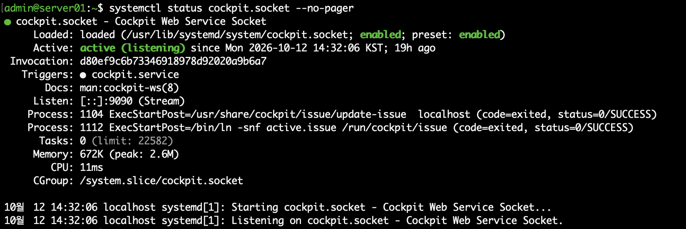
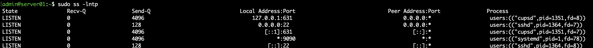

# 03. Linux Process & Service Management

## 1. 실습 목표

Rocky Linux에서 systemd 기반 서비스 관리 방법을 이해하고, SSH 및 Cockpit 서비스의 실행 상태와 부팅 시 자동 실행 여부를 확인한다.

또한 `ss` 명령어를 이용해 실제로 수신 대기 중인 네트워크 포트와 해당 프로세스를 확인한다.

## 2. 실습 환경

| 항목 | 내용 |
|---|---|
| OS | Rocky Linux 10.2 ARM64 |
| Virtualization | VMware Fusion |
| Hostname | server01.example.com |
| 관리 계정 | admin |
| 접속 방식 | SSH |

## 3. 서비스 실행 상태 확인

### SSH 서비스

```bash
systemctl is-active sshd
systemctl is-enabled sshd
```

실행 결과:

```text
active
enabled
```

### firewalld 서비스

```bash
systemctl is-active firewalld
systemctl is-enabled firewalld
```

실행 결과:

```text
active
enabled
```

- `active`: 현재 서비스가 실행 중인 상태
- `enabled`: 시스템 부팅 시 자동 시작하도록 설정된 상태

## 4. TCP LISTEN 포트 확인

```bash
sudo ss -lntp
```

실행 결과에서 확인된 주요 포트:

| 포트 | 프로세스 | 역할 |
|---|---|---|
| 22/TCP | sshd | SSH 원격 접속 |
| 631/TCP | cupsd | 프린터 서비스 |
| 9090/TCP | systemd | Cockpit 소켓 |

SSH 포트 확인:

```bash
sudo ss -lntp | grep ':22'
```

8080 포트 확인:

```bash
sudo ss -lntp | grep ':8080'
```

8080 포트에서 수신 대기 중인 프로세스는 확인되지 않았다.

## 5. Cockpit Socket Activation

Cockpit 소켓 상태 확인:

```bash
systemctl status cockpit.socket
```

실행 결과:

```text
Active: active (listening)
Triggers: cockpit.service
Listen: [::]:9090 (Stream)
```

부팅 시 자동 실행 확인:

```bash
systemctl is-enabled cockpit.socket
```

실행 결과:

```text
enabled
```

포트 확인:

```bash
sudo ss -lntp | grep ':9090'
```

Cockpit은 systemd의 Socket Activation 기능을 이용한다.

systemd가 TCP 9090 포트에서 연결을 기다리다가 클라이언트의 접속 요청이 발생하면 연결된 Cockpit 서비스를 활성화할 수 있다.

## 6. 실습 결과

- [x] SSH 서비스 실행 상태 확인
- [x] firewalld 서비스 실행 상태 확인
- [x] 부팅 시 자동 실행 여부 확인
- [x] TCP LISTEN 포트 확인
- [x] SSH 22번 포트 확인
- [x] Cockpit 소켓 상태 확인
- [x] Socket Activation 구조 이해
- [ ] 프로세스 우선순위 및 nice/renice 실습
- [ ] 서비스 시작·중지·재시작 실습

## 7. 배운 내용

- `systemctl`을 이용한 서비스 상태 확인
- `active`와 `enabled`의 차이
- `ss -lntp`를 이용한 포트와 프로세스 확인
- systemd Socket Activation 개념
- 방화벽 포트 허용과 실제 LISTEN 상태의 차이

## 8. 실습 증빙

### Cockpit 소켓 확인



### TCP LISTEN 포트 확인


