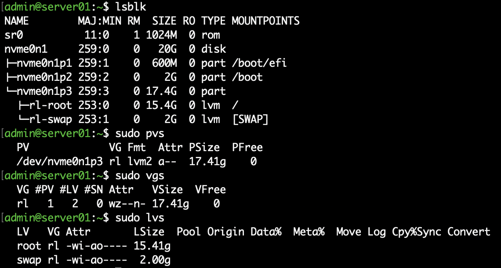
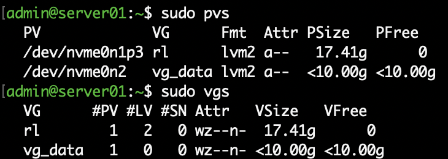
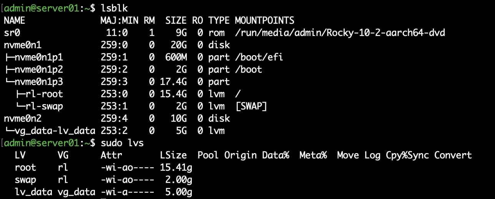
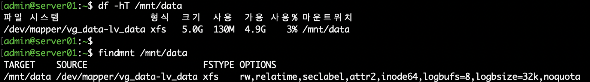
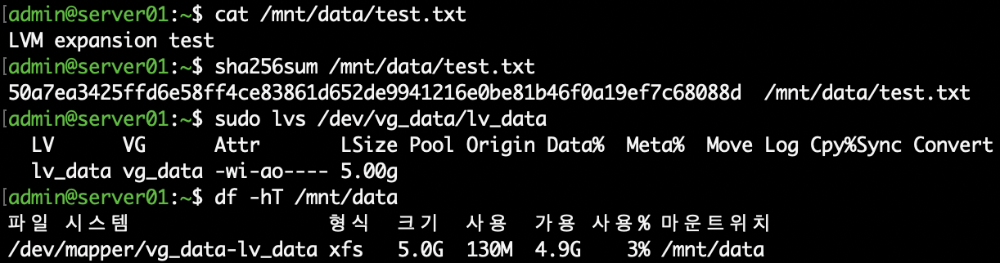
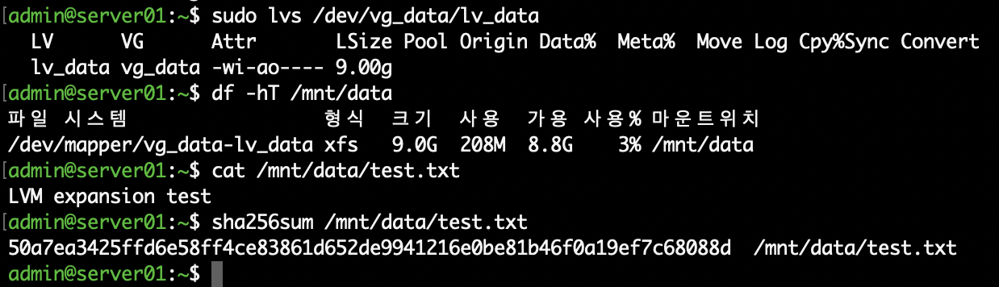
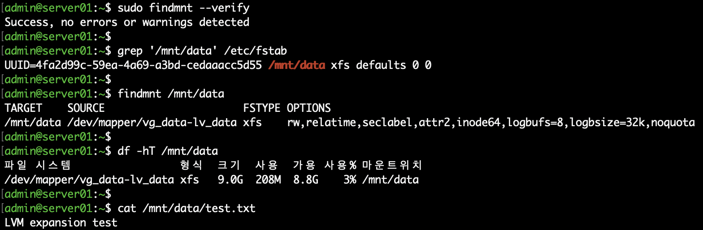

# 04. Linux 저장장치 및 LVM 관리

## 1. 실습 개요

VMware Fusion 기반 Rocky Linux 서버에 별도의 가상 디스크를 추가하고 LVM(Logical Volume Manager)을 이용하여 저장장치를 구성하였다.

운영체제가 설치된 기존 디스크와 실습 디스크를 분리하여 데이터 손상 위험을 줄이고, PV·VG·LV 생성부터 XFS 파일시스템 구성, 용량 확장, 자동 마운트 설정까지 진행하였다.

특히 LV와 파일시스템의 크기가 서로 다른 상황을 직접 확인하고, XFS 확장을 통해 해결하는 과정을 실습하였다.

## 2. 실습 환경

| 항목 | 내용 |
|---|---|
| 가상화 환경 | VMware Fusion |
| 운영체제 | Rocky Linux 10.2 (ARM64) |
| 호스트명 | server01.example.com |
| 기존 OS 디스크 | /dev/nvme0n1 (20GiB) |
| 추가 실습 디스크 | /dev/nvme0n2 (10GiB) |
| VG | vg_data |
| LV | lv_data |
| 파일시스템 | XFS |
| 마운트 위치 | /mnt/data |

## 3. 기존 저장장치 확인

작업 전에 현재 디스크 및 LVM 상태를 확인하였다.

```bash
lsblk -f
lsblk -o NAME,SIZE,TYPE,FSTYPE,MOUNTPOINTS
sudo pvs
sudo vgs
sudo lvs
df -hT
```

확인 결과 기존 시스템은 `/dev/nvme0n1` 디스크에 설치되어 있었으며, `rl` 볼륨 그룹에 root와 swap LV가 구성되어 있었다.

기존 VG에는 여유 공간이 없으므로 VMware Fusion에서 별도의 10GiB 가상 디스크를 추가하였다.



## 4. PV 및 VG 생성

### 4.1 신규 디스크 확인 및 PV 생성

새롭게 추가된 `/dev/nvme0n2` 디스크를 확인한 다음 LVM 물리 볼륨으로 초기화하였다.

```bash
sudo wipefs -n /dev/nvme0n2
sudo pvcreate /dev/nvme0n2
sudo pvs
```

PV 생성 결과:

```text
/dev/nvme0n2  lvm2  10.00g
```

### 4.2 VG 생성

```bash
sudo vgcreate vg_data /dev/nvme0n2
sudo pvs
sudo vgs
```

`vg_data` 볼륨 그룹이 생성되고, 약 10GiB의 공간을 사용할 수 있음을 확인하였다.



## 5. LV 생성

`vg_data` 안에 5GiB 크기의 논리 볼륨을 생성하였다.

```bash
sudo lvcreate -L 5G -n lv_data vg_data
sudo lvs
lsblk -o NAME,SIZE,TYPE,FSTYPE,MOUNTPOINTS
```

생성된 논리 볼륨 경로:

```text
/dev/vg_data/lv_data
```

최초 LV 크기는 5GiB로 설정하고, 이후 확장 실습을 진행하였다.



## 6. XFS 파일시스템 생성 및 마운트

새로 생성된 LV에 XFS 파일시스템을 구성하였다.

```bash
sudo mkfs.xfs /dev/vg_data/lv_data
sudo mkdir -p /mnt/data
sudo mount /dev/vg_data/lv_data /mnt/data
```

마운트 상태 확인:

```bash
df -hT /mnt/data
findmnt /mnt/data
```

검증 결과 XFS 파일시스템이 `/mnt/data`에 마운트되었으며, 초기 용량은 약 5GiB였다.



## 7. LVM 온라인 용량 확장

### 7.1 확장 전 테스트 데이터 생성

파일시스템을 확장하기 전에 테스트 파일을 생성하여 데이터 보존 여부를 확인할 수 있도록 하였다.

```bash
echo "LVM expansion test" | sudo tee /mnt/data/test.txt
cat /mnt/data/test.txt
sha256sum /mnt/data/test.txt
```

확장 전 LV 및 파일시스템 용량을 확인하였다.

```bash
sudo lvs /dev/vg_data/lv_data
df -hT /mnt/data
```



### 7.2 논리 볼륨 확장

LV를 최초 5GiB에서 8GiB로 확장하였다.

이후 LV만 추가로 1GiB 확장하여, 파일시스템을 확장하지 않았을 때 어떤 차이가 발생하는지 확인하였다.

```bash
sudo lvextend -L +1G /dev/vg_data/lv_data
sudo lvs /dev/vg_data/lv_data
df -hT /mnt/data
```

추가 확장 직후 확인 결과:

| 항목 | 용량 |
|---|---|
| LV | 9GiB |
| XFS 파일시스템 | 8GiB |

LV 자체는 확장되었지만 XFS 파일시스템은 아직 기존 크기를 유지하고 있었다.

### 7.3 XFS 파일시스템 확장

```bash
sudo xfs_growfs /mnt/data
```

확장 후 확인:

```bash
sudo lvs /dev/vg_data/lv_data
df -hT /mnt/data
cat /mnt/data/test.txt
sha256sum /mnt/data/test.txt
```

최종적으로 XFS 파일시스템 용량이 약 9GiB로 증가하였다.

기존 테스트 파일의 내용도 유지되는 것을 확인하였다.



## 8. /etc/fstab 자동 마운트 구성

### 8.1 파일시스템 UUID 확인

```bash
sudo blkid /dev/vg_data/lv_data
```

확인한 UUID:

```text
4fa2d99c-59ea-4a69-a3bd-cedaaacc5d55
```

### 8.2 자동 마운트 설정

기존 `/etc/fstab`을 백업하고 UUID 기반의 마운트 항목을 추가하였다.

```bash
sudo cp -a /etc/fstab /etc/fstab.bak
sudo vi /etc/fstab
```

추가한 설정:

```text
UUID=4fa2d99c-59ea-4a69-a3bd-cedaaacc5d55 /mnt/data xfs defaults 0 0
```

### 8.3 설정 검증

```bash
sudo systemctl daemon-reload
sudo findmnt --verify
```

검증 결과:

```text
Success, no errors or warnings detected
```

재부팅 없이 마운트를 해제한 뒤 `/etc/fstab` 설정을 사용해 다시 마운트하는 방식으로 테스트하였다.

```bash
sudo umount /mnt/data
sudo mount /mnt/data
```

이후 마운트 상태와 기존 데이터가 유지되는지 확인하였다.

## 9. 문제 해결 — 중복 마운트

마운트 검증 과정에서 동일한 LV가 `/mnt/data`에 두 번 마운트된 상태를 발견하였다.

```bash
findmnt --kernel -rn -o TARGET,SOURCE,FSTYPE
```

동일한 마운트 항목이 중복 출력되는 것을 확인하고, `umount`를 사용하여 중복 마운트를 하나씩 해제하였다.

이후 `/etc/fstab`에 등록된 설정으로 다시 마운트하는 절차를 진행하였다.

최종 검증에 사용한 명령어:

```bash
sudo findmnt --verify
grep '/mnt/data' /etc/fstab
findmnt /mnt/data
df -hT /mnt/data
cat /mnt/data/test.txt
```



## 10. 실습 결과 및 학습 내용

이번 실습을 통해 다음 사항을 학습하였다.

- 운영체제 디스크와 실습용 디스크 분리
- PV, VG, LV 생성 및 계층 구조 이해
- XFS 파일시스템 생성 및 마운트
- 기존 데이터를 유지한 상태에서 LV 및 XFS 용량 확장
- LV 크기와 파일시스템 크기가 일치하지 않는 상황 분석
- UUID 기반 `/etc/fstab` 설정 및 검증
- 중복 마운트 현상 확인 및 해제

**핵심 학습 내용**

LVM 논리 볼륨을 확장하더라도 파일시스템이 자동으로 확장되는 것은 아니다. XFS 파일시스템을 사용하는 경우 `xfs_growfs`를 통해 확장된 저장 공간을 사용하도록 설정해야 한다.

또한 마운트 설정을 변경할 때에는 기존 마운트 상태를 확인하고, `/etc/fstab` 검증을 통해 잘못된 설정으로 인한 시스템 장애를 예방해야 한다.
