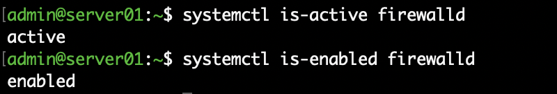
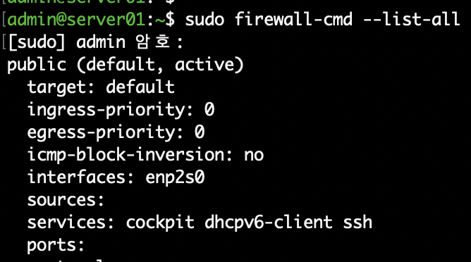
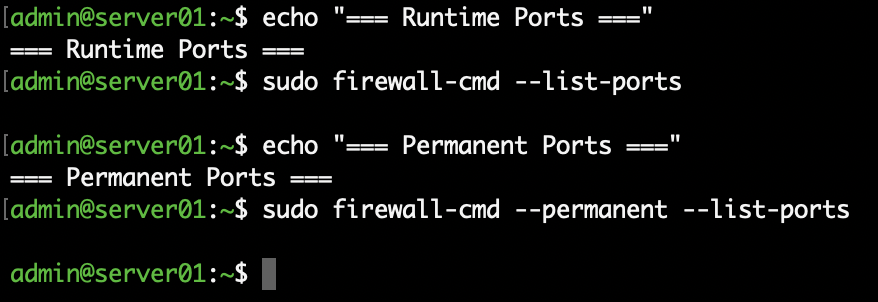

# 06. Linux Security - Firewall Management

## 1. 실습 목표

Rocky Linux의 firewalld를 사용하여 방화벽 서비스 상태와 Zone 구성을 확인하고, TCP 포트의 허용 및 삭제를 실습한다.

Runtime과 Permanent 설정의 차이를 이해하고, 변경한 방화벽 규칙을 원상복구하는 과정을 검증한다.

## 2. 실습 환경

| 항목 | 내용 |
|---|---|
| OS | Rocky Linux 10.2 ARM64 |
| Virtualization | VMware Fusion |
| Hostname | server01.example.com |
| Network Interface | enp2s0 |
| Firewall | firewalld |
| Active Zone | public |
| Remote Access | SSH (TCP 22) |

## 3. 방화벽 서비스 확인

```bash
systemctl is-active firewalld
systemctl is-enabled firewalld
```

확인 결과:

- active: 현재 실행 중
- enabled: 부팅 시 자동 실행 설정

## 4. 방화벽 Zone 확인

```bash
sudo firewall-cmd --get-active-zones
sudo firewall-cmd --list-all
```

실습 결과:

- Zone: public
- Interface: enp2s0
- Allowed Services: cockpit, dhcpv6-client, ssh

SSH 원격 연결을 유지하기 위해 기존 SSH 허용 규칙은 변경하지 않았다.

## 5. Runtime 포트 허용

테스트용 TCP 8080 포트를 Runtime에 추가하였다.

```bash
sudo firewall-cmd --add-port=8080/tcp
sudo firewall-cmd --list-ports
```

확인 결과:

```text
8080/tcp
```

Runtime 규칙은 즉시 적용되지만 재시작이나 설정 재적용 이후 유지되지 않을 수 있다.

## 6. Permanent 포트 허용

```bash
sudo firewall-cmd --permanent --add-port=8080/tcp
sudo firewall-cmd --permanent --list-ports
```

확인 결과:

```text
8080/tcp
```

Permanent 설정은 영구 구성에 저장된다.

이번 실습에서는 Runtime에 이미 동일한 규칙이 존재했으므로 별도 reload 없이 두 설정을 비교하였다.

## 7. 방화벽 원상복구

테스트가 완료된 후 Runtime과 Permanent 설정에서 모두 포트를 제거하였다.

```bash
sudo firewall-cmd --remove-port=8080/tcp
sudo firewall-cmd --permanent --remove-port=8080/tcp
```

삭제 검증:

```bash
sudo firewall-cmd --list-ports
sudo firewall-cmd --permanent --list-ports
```

두 명령어에서 별도로 허용된 포트가 출력되지 않는 것을 확인하였다.

## 8. 방화벽과 서비스 포트의 차이

```bash
sudo ss -lntp
sudo ss -lntp | grep ':8080'
```

8080 포트에서 수신 대기 중인 프로세스가 없음을 확인하였다.

방화벽에서 특정 포트를 허용하는 것과 애플리케이션이 해당 포트를 실제로 사용하는 것은 서로 다른 개념임을 확인하였다.

## 9. 실습 결과

- [x] firewalld 실행 상태 확인
- [x] 부팅 자동 실행 여부 확인
- [x] 활성 Zone 및 허용 서비스 확인
- [x] Runtime 포트 추가 및 확인
- [x] Permanent 포트 추가 및 확인
- [x] 테스트 포트 삭제 및 원상복구
- [x] 실제 TCP LISTEN 포트 확인
- [ ] SELinux 정책 관리
- [ ] SSH 보안 강화

## 10. 실습 증빙

### 방화벽 서비스 상태



### 방화벽 Zone 설정



### 방화벽 포트 원상복구



## 11. 배운 내용

- firewalld의 Zone 개념
- Runtime과 Permanent 규칙의 차이
- 포트 허용 및 삭제 명령어
- 변경 전후 검증과 원상복구의 중요성
- SSH 원격 관리 중 방화벽 변경 시 주의사항
