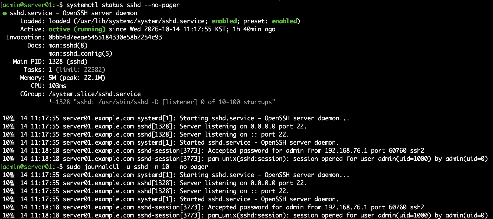
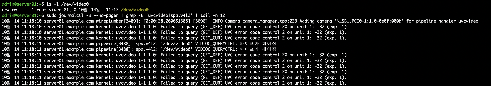
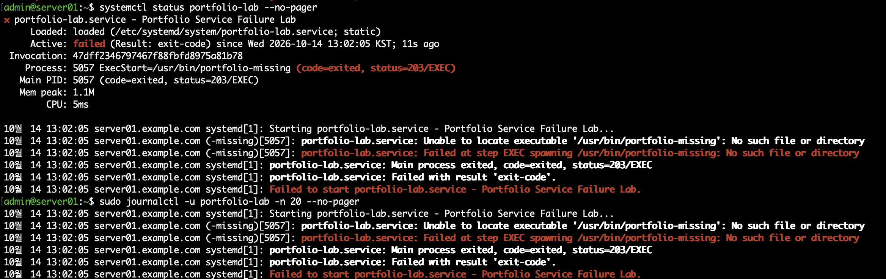
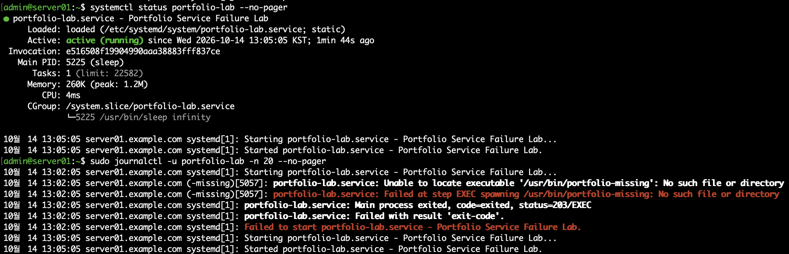

# 07. Linux 로그 분석 및 서비스 장애 대응

## 1. 실습 개요

Rocky Linux 서버에서 `systemctl`과 `journalctl`을 활용하여 서비스 상태 및 시스템 로그를 분석하였다.

SSH 서비스의 정상 동작을 확인하고, 시스템 오류 로그에서 비디오 장치 관련 메시지를 조사하였다.

또한 실습용 systemd 서비스를 생성하여 의도적으로 실행 오류를 발생시킨 후, 로그 분석을 통해 원인을 파악하고 정상적으로 복구하는 과정을 수행하였다.

이번 실습의 목적은 Linux 서버에서 장애 발생 시 로그를 기반으로 원인을 분석하고 해결 결과를 검증하는 능력을 익히는 것이다.

## 2. 실습 환경

| 항목 | 내용 |
|---|---|
| 가상화 환경 | VMware Fusion |
| 운영체제 | Rocky Linux 10.2 (ARM64) |
| 서버 호스트명 | server01.example.com |
| 관리 계정 | admin |
| 주요 도구 | systemctl, journalctl, grep, tail |
| 분석 서비스 | sshd |
| 장애 재현 서비스 | portfolio-lab.service |

---

## 3. SSH 서비스 상태 및 로그 분석

### 3.1 서비스 상태 확인

```bash
systemctl status sshd --no-pager
```

확인 결과:

```text
Loaded: loaded (...; enabled; ...)
Active: active (running)
Main PID: 1328 (sshd)
```

SSH 서비스가 정상적으로 실행 중이며, 재부팅 시 자동 실행되도록 설정되어 있음을 확인하였다.

### 3.2 SSH 서비스 로그 확인

```bash
sudo journalctl -u sshd -n 20 --no-pager
```

주요 로그:

```text
Server listening on 0.0.0.0 port 22.
Server listening on :: port 22.
Accepted password for admin ...
```

로그를 통해 TCP 22번 포트에서 SSH 연결을 대기하고 있으며, `admin` 계정의 SSH 인증이 성공한 것을 확인하였다.



---

## 4. 시스템 오류 로그 분석

### 4.1 오류 로그 조회

현재 부팅 이후 발생한 오류 로그를 조회하였다.

```bash
sudo journalctl -b -p err -n 10 --no-pager
```

조회 결과, `uvcvideo` 및 `pipewire`와 관련된 오류가 발견되었다.

```text
uvcvideo: Failed to query (GET_DEF) ...
pipewire: '/dev/video0' VIDIOC_QUERYCTRL: 파이프가 깨어짐
```

### 4.2 관련 장치 및 커널 로그 확인

```bash
ls -l /dev/video0
```

확인 결과:

```text
crw-rw----+ 1 root video 81, 0 /dev/video0
```

비디오 장치 파일이 존재함을 확인하였다.

관련 커널 로그를 추가로 조사하였다.

```bash
sudo journalctl -k -b --no-pager | grep -i uvcvideo | tail -n 20
```

비디오 장치 제어 정보 조회 실패 및 UVC 호환성 관련 메시지를 확인하였다.

```text
UVC non compliance: permanently disabling control ...
Failed to query (GET_CUR) ...
```

### 4.3 원인 분석

- `/dev/video0` 장치가 시스템에 인식되어 있었다.
- `uvcvideo` 드라이버에서 장치 제어 정보 조회 오류가 발생하였다.
- `pipewire`에서도 같은 장치에 대한 제어 정보 조회 실패가 기록되었다.
- 가상화 환경의 카메라 장치 호환성 또는 통신 문제 가능성을 확인하였다.

로그만으로 정확한 하드웨어 또는 가상화 설정의 원인을 확정할 수는 없으므로, 불필요한 드라이버 변경은 수행하지 않았다.

SSH 서비스는 별도로 정상 동작하고 있음을 확인하였다.



---

## 5. systemd 서비스 장애 재현

### 5.1 장애 재현 목적

서비스 실행 파일 경로가 잘못 설정되었을 때 발생하는 오류를 확인하기 위해 별도의 실습용 systemd 서비스를 생성하였다.

실제 SSH 및 네트워크 서비스에 영향을 주지 않도록 독립적인 서비스를 사용하였다.

### 5.2 서비스 파일 생성

```bash
sudo vi /etc/systemd/system/portfolio-lab.service
```

초기 설정:

```ini
[Unit]
Description=Portfolio Service Failure Lab

[Service]
Type=exec
ExecStart=/usr/bin/portfolio-missing
```

존재하지 않는 실행 파일을 `ExecStart`에 지정하여 의도적인 장애를 발생시켰다.

### 5.3 서비스 시작 및 오류 확인

```bash
sudo systemctl daemon-reload
sudo systemctl start portfolio-lab
```

서비스 상태 조회:

```bash
systemctl status portfolio-lab --no-pager
```

확인 결과:

```text
Active: failed (Result: exit-code)
status=203/EXEC
```

### 5.4 장애 로그 분석

```bash
sudo journalctl -u portfolio-lab -n 20 --no-pager
```

주요 로그:

```text
Unable to locate executable '/usr/bin/portfolio-missing'
No such file or directory
Failed at step EXEC
status=203/EXEC
```

로그를 분석한 결과, 서비스 설정에 지정된 실행 파일이 존재하지 않아 systemd가 실행 단계에서 실패한 것으로 확인하였다.

**장애 원인:** 잘못된 `ExecStart` 실행 파일 경로



---

## 6. 서비스 장애 복구

### 6.1 서비스 설정 수정

기존 서비스 파일의 실행 명령을 실제로 존재하는 프로그램으로 변경하였다.

수정 전:

```ini
ExecStart=/usr/bin/portfolio-missing
```

수정 후:

```ini
ExecStart=/usr/bin/sleep infinity
```

`/usr/bin/sleep infinity`는 실습용으로 프로세스가 실행 상태를 유지하도록 하기 위해 사용하였다.

### 6.2 변경 사항 적용 및 서비스 시작

```bash
sudo systemctl daemon-reload
sudo systemctl start portfolio-lab
```

### 6.3 서비스 복구 확인

```bash
systemctl status portfolio-lab --no-pager
```

실제 확인 결과:

```text
Active: active (running)
Main PID: 5225 (sleep)
```

서비스 프로세스가 정상적으로 실행 상태를 유지함을 확인하였다.

### 6.4 로그를 통한 복구 확인

```bash
sudo journalctl -u portfolio-lab -n 20 --no-pager
```

로그에서 다음 순서가 확인되었다.

```text
13:02:05 Failed at step EXEC
13:02:05 status=203/EXEC
13:02:05 Failed to start portfolio-lab.service

13:05:05 Starting portfolio-lab.service
13:05:05 Started portfolio-lab.service
```

기존에는 실행 파일을 찾지 못해 서비스가 시작되지 않았으나, 설정 수정 후 정상적으로 실행되었다.

이번 검증은 실습용 프로세스의 정상 실행을 확인한 것이며 실제 애플리케이션의 기능 검증과는 구분된다.



---

## 7. 장애 분석 및 해결 결과 요약

| 구분 | 내용 |
|---|---|
| 장애 대상 | portfolio-lab.service |
| 장애 유형 | systemd 서비스 실행 실패 |
| 오류 코드 | 203/EXEC |
| 원인 | 존재하지 않는 실행 파일 지정 |
| 해결 방법 | ExecStart 수정 및 daemon-reload |
| 검증 명령어 | systemctl status, journalctl |
| 최종 결과 | active (running) |

이번 서비스 장애는 문제 해결 절차를 학습하기 위해 의도적으로 재현한 사례이다.

## 8. 실습 결과 및 학습 내용

이번 실습을 통해 다음 사항을 학습하였다.

- `systemctl`을 이용한 서비스 실행 상태 확인
- `journalctl`을 이용한 서비스별 로그 조회
- 커널 및 시스템 오류 메시지 분석
- 정상 서비스 로그와 오류 로그의 구분
- systemd 서비스의 `203/EXEC` 오류 원인 분석
- 서비스 설정 변경 및 정상 복구 검증
- 장애 발생 전후 로그를 통한 조치 결과 확인

**핵심 학습 내용**

Linux 서버에서 서비스 장애가 발생했을 때 단순히 서비스를 재시작하는 것보다, 실행 상태와 로그를 먼저 확인하여 원인을 파악하는 것이 중요하다는 점을 학습하였다.

또한 문제 해결 후에는 서비스 상태 및 로그를 다시 확인하여 조치 결과를 검증해야 한다는 것을 직접 실습하였다.
