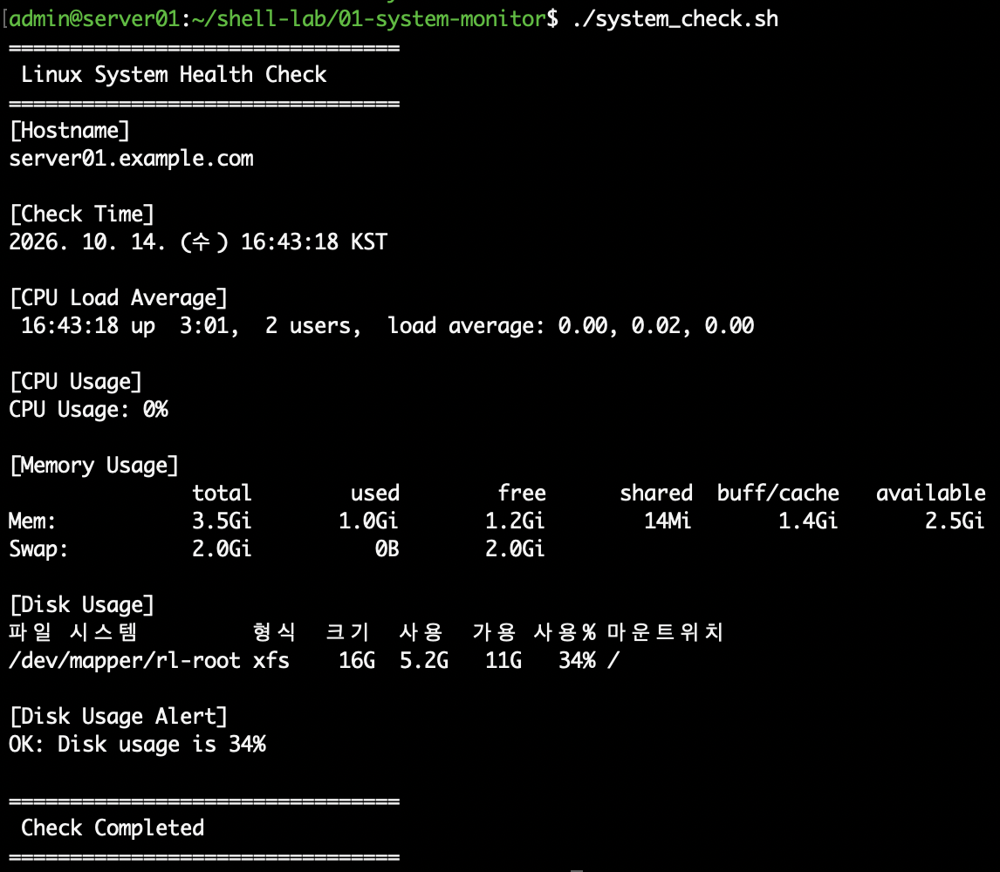

# 01. Linux 시스템 자원 점검 자동화

## 1. 실습 개요

Rocky Linux 서버의 CPU, 메모리, 디스크 사용 현황을 한 번에 확인할 수 있는 Bash Shell Script를 작성하였다.

기존에는 개별 명령어를 사용하여 시스템 상태를 확인하였으나, 반복적인 점검 작업을 간소화하기 위해 자동 점검 스크립트를 구현하였다.

디스크 사용률이 지정한 기준값 이상일 경우 경고 메시지를 출력하도록 조건문을 추가하였다.

## 2. 실습 환경

| 구분 | 내용 |
|---|---|
| 운영체제 | Rocky Linux 10.2 ARM64 |
| 가상화 | VMware Fusion |
| 호스트명 | server01.example.com |
| 스크립트 | system_check.sh |
| 사용 언어 | Bash |
| 사용 명령어 | hostname, date, uptime, free, df, awk |

## 3. 구현 기능

| 점검 항목 | 구현 방법 |
|---|---|
| 서버 호스트명 | hostname |
| 점검 시간 | date |
| CPU 부하 평균 | uptime |
| CPU 사용률 | /proc/stat 변화량 계산 |
| 메모리 사용량 | free -h |
| 디스크 사용량 | df -hT / |
| 디스크 경고 | awk, if 조건문 |

CPU 사용률은 `/proc/stat`에서 1초 간격으로 CPU 누적 사용 시간을 읽어 변화량을 계산하였다.

디스크 사용률은 `df`와 `awk`를 이용하여 숫자로 추출한 후, 설정된 임계값과 비교하였다.

## 4. 스크립트 실행 방법

스크립트 실행 권한을 부여한다.

`chmod +x system_check.sh`

스크립트를 실행한다.

`./system_check.sh`

전체 소스코드: [system_check.sh](./system_check.sh)

## 5. 정상 실행 결과

2026년 10월 14일 실제 서버에서 확인한 결과이다.

| 점검 항목 | 결과 |
|---|---|
| CPU 부하 평균 | 0.01 / 0.02 / 0.00 |
| CPU 사용률 | 1% |
| 전체 메모리 | 3.5GiB |
| 사용 메모리 | 1.0GiB |
| 루트 디스크 사용률 | 34% |
| 디스크 경고 기준 | 80% |
| 점검 결과 | OK |

실행 결과 디스크 사용률이 경고 기준값보다 낮아 정상 메시지가 출력되었다.

`OK: Disk usage is 34%`

## 6. 디스크 사용률 경고 기능

디스크 사용률이 80% 이상이면 WARNING 메시지가 출력되도록 구현하였다.

주요 조건문:

`if [ "$DISK_USAGE" -ge "$THRESHOLD" ]; then`

정상 상태에서는 `OK`, 임계값 이상에서는 `WARNING` 메시지를 출력한다.

실제 디스크를 가득 채우지 않고 경고 조건을 검증할 수 있도록 임계값을 임시로 조정하는 방법을 사용하였다.

기준값 변경 테스트를 마친 후 운영 기준인 80%로 복구하였다.

## 7. 실습 결과 및 학습 내용

이번 실습을 통해 다음 내용을 학습하였다.

- Bash Script를 이용한 반복 점검 작업 자동화
- `/proc/stat` 기반 CPU 사용률 계산
- `awk`를 이용한 명령어 출력 데이터 추출
- 변수와 조건문을 이용한 디스크 경고 판단
- 점검 결과 검증 및 임계값 관리

## 8. 향후 개선 계획

- 점검 결과를 날짜별 로그 파일로 저장
- CPU·메모리 사용률 경고 기능 확장
- cron을 이용한 정기 실행
- 장애 발생 시 로그 분석 및 알림 기능 연계
