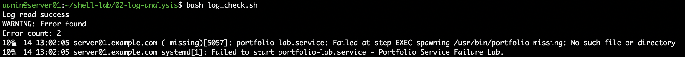
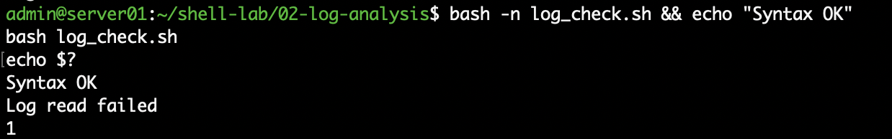

# 02. Linux 로그 분석 자동화

## 1. 실습 개요

Rocky Linux 서버에서 발생한 시스템 오류 로그를 자동으로 검색하고 분석하는 Bash Shell Script를 작성하였다.

Linux 로그 및 장애 대응 실습에서 사용했던 `journalctl`을 기반으로, 특정 서비스의 오류 기록을 추출하고 발견된 로그의 개수와 상세 내용을 출력하도록 구현하였다.

단순한 로그 검색뿐 아니라 로그 조회 명령어가 실패했을 경우 스크립트를 종료하도록 예외 처리 기능도 추가하였다.

## 2. 실습 환경

| 구분 | 내용 |
|---|---|
| 운영체제 | Rocky Linux 10.2 ARM64 |
| 가상화 | VMware Fusion |
| 호스트명 | server01.example.com |
| 사용 언어 | Bash |
| 스크립트 | log_check.sh |
| 주요 명령어 | journalctl, grep, printf, wc |
| 분석 대상 | portfolio-lab.service |

## 3. 주요 구현 기능

| 기능 | 구현 방법 |
|---|---|
| 시스템 오류 로그 조회 | journalctl -b -p err |
| 로그 조회 성공 여부 확인 | if 조건문과 명령어 종료 상태 |
| 특정 서비스 로그 검색 | grep |
| 검색 결과 저장 | 명령어 치환 `$()` |
| 오류 존재 여부 판단 | `-n` 문자열 조건 검사 |
| 오류 로그 개수 계산 | printf, wc -l |
| 상세 오류 내용 출력 | echo |
| 로그 조회 실패 처리 | exit 1 |

전체 소스코드: [log_check.sh](./log_check.sh)

## 4. 스크립트 실행 방법

Rocky Linux에서 스크립트가 있는 디렉터리로 이동한 후 실행한다.

```bash
bash -n log_check.sh
bash log_check.sh
```

`bash -n`으로 문법을 검사하고, `bash log_check.sh`로 스크립트를 실행한다.

시스템 로그 조회 과정에서 sudo 권한이 필요할 수 있으며, 실행 중 비밀번호를 요청할 수 있다.

## 5. 로그 조회 및 분석 과정

### 5.1 시스템 오류 로그 조회

```bash
sudo journalctl -b -p err --no-pager
```

현재 부팅 이후 발생한 오류 등급 이상의 시스템 로그를 조회하였다.

### 5.2 로그 조회 실패 처리

`if` 조건문으로 `journalctl` 실행 성공 여부를 확인하도록 구현하였다.

로그 조회에 실패하면 다음 메시지를 출력하고 스크립트를 종료한다.

```text
Log read failed
```

실패 시 `exit 1`을 실행하여 로그를 읽지 못한 상황이 정상 상태로 잘못 처리되지 않도록 하였다.

### 5.3 특정 서비스 오류 검색

전체 오류 로그에서 `portfolio-lab` 문자열이 포함된 줄을 추출하도록 구현하였다.

```bash
ERROR_LOG=$(printf '%s\n' "$JOURNAL_LOG" | grep "portfolio-lab")
```

앞서 조회한 로그를 `JOURNAL_LOG` 변수에 저장한 뒤 재사용하여 불필요한 로그 조회를 줄였다.

### 5.4 오류 개수 계산

검색 결과가 존재할 경우 `wc -l`을 사용하여 발견된 로그의 줄 수를 계산하였다.

```bash
ERROR_COUNT=$(printf '%s\n' "$ERROR_LOG" | wc -l)
```

이때 `ERROR_COUNT`는 개별 장애 사건의 수가 아니라 **검색 조건과 일치한 로그의 줄 수**를 나타낸다.

## 6. 오류 탐지 검증

Linux 서비스 장애 대응 실습에서 의도적으로 발생시킨 `portfolio-lab.service` 실행 실패 기록을 대상으로 테스트하였다.

### 실행 결과

```text
Log read success
WARNING: Error found
Error count: 2
```

검색된 로그에서 다음 오류 내용을 확인하였다.

```text
Failed at step EXEC spawning /usr/bin/portfolio-missing
No such file or directory
Failed to start portfolio-lab.service
```

존재하지 않는 실행 파일을 지정하여 발생했던 과거 오류 기록 2줄이 정상적으로 검색되었다.

해당 결과는 현재 서비스의 장애 상태가 아닌 **과거에 기록된 오류의 존재 여부**를 나타낸다.



## 7. 로그 조회 실패 상황 검증

### 7.1 테스트 목적

로그 조회 명령어 자체가 실패했을 때도 스크립트가 정상적인 상태와 구분하여 처리하는지 검증하였다.

### 7.2 장애 재현 방법

실제 시스템 로그를 변경하지 않고, 테스트 중 `journalctl` 실행 부분을 실패 상태를 반환하는 `false` 명령어로 임시 변경하였다.

```bash
if JOURNAL_LOG=$(false); then
```

### 7.3 검증 결과

```text
Log read failed
```

스크립트가 실패 상태 코드 `1`로 종료되도록 구성하였으며, 이후의 오류 검색 및 정상 상태 판단을 진행하지 않음을 검증하였다.

테스트 종료 후에는 임시로 변경한 명령어를 원래의 `sudo journalctl`로 복구하였다.



## 8. 실습 결과 및 학습 내용

이번 실습을 통해 다음 내용을 학습하였다.

- `journalctl`을 이용한 시스템 로그 수집
- `grep`을 이용한 특정 서비스 오류 검색
- `$()`를 활용한 명령어 실행 결과 저장
- 변수를 재사용하여 중복 명령어 실행 줄이기
- `printf`와 `wc -l`을 이용한 로그 개수 계산
- `if`, `-n`을 이용한 조건 판단
- `exit 1`을 이용한 오류 처리
- 정상적인 로그 조회와 조회 명령 실패 상황의 구분

특히 로그 검색 결과가 없는 경우와 로그 조회 자체가 실패한 경우를 구분해야 한다는 점을 학습하였다.

## 9. 향후 개선 계획

- 검색 대상 서비스 및 키워드를 인수로 지정하는 기능
- 조회 기간을 설정하는 기능
- 로그 분석 결과 파일 저장
- cron 기반 정기 실행
- 오류 발생 시 알림 기능
- 검색 명령 자체의 오류 상태를 구분하는 기능

이번 스크립트는 로그 분석 자동화의 기초 실습으로, 향후 서버 점검 자동화와 연계하여 확장할 계획이다.
