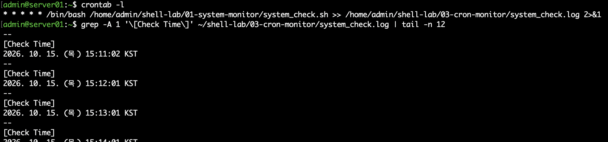
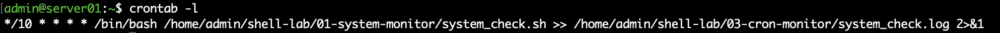
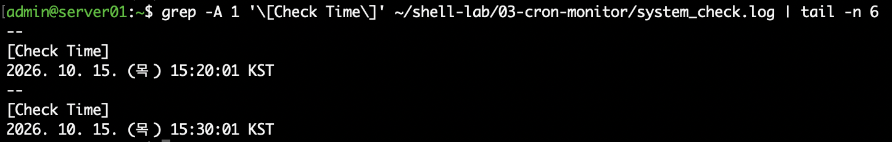

# 03. cron 기반 Linux 서버 정기 점검 자동화

## 1. 실습 개요

Rocky Linux 환경에서 `cron`을 활용하여 서버 상태 점검을 자동화하였다.

기존에 작성한 `system_check.sh`를 재사용하여 CPU, 메모리, 디스크 사용률을 주기적으로 확인하고, 실행 결과를 로그 파일에 누적 저장하도록 구성하였다.

최초에는 1분 간격으로 자동 실행을 검증하고, 이후 10분 간격으로 변경하여 실제 예약 실행 여부를 확인하였다.

## 2. 실습 환경

| 항목 | 내용 |
|---|---|
| OS | Rocky Linux 10.2 ARM64 |
| 가상화 | VMware Fusion |
| 호스트명 | server01.example.com |
| 실행 계정 | admin |
| 스케줄러 | crond |
| 실행 스크립트 | system_check.sh |
| 실행 주기 | 10분 |
| 로그 저장 파일 | system_check.log |

## 3. 시스템 구성

기존 서버 점검 스크립트를 cron으로 주기적으로 실행하고, 실행 결과를 로그 파일에 저장하도록 구성하였다.

**동작 흐름**

1. crond 서비스가 예약된 실행 시간을 확인
2. 10분마다 system_check.sh 실행
3. CPU, 메모리, 디스크 사용률 점검
4. 점검 결과 및 오류 출력을 로그 파일에 저장
5. 저장된 로그를 통해 실행 여부 확인

기존 점검 스크립트: [01. Linux 시스템 자원 점검 자동화](../01-system-monitor/README.md)

## 4. cron 서비스 확인

먼저 cron 서비스의 실행 상태를 확인하였다.

```bash
sudo systemctl status crond --no-pager
```

**확인 결과**

- `active (running)`: cron 서비스 실행 중
- `enabled`: 시스템 부팅 시 자동 실행 설정

## 5. crontab 설정

### 5.1 테스트용 1분 간격 실행

자동 실행 여부를 빠르게 검증하기 위해 처음에는 매분 실행하도록 설정하였다.

```cron
* * * * * /bin/bash /home/admin/shell-lab/01-system-monitor/system_check.sh >> /home/admin/shell-lab/03-cron-monitor/system_check.log 2>&1
```

`crontab -e`로 설정을 등록하고, `crontab -l`로 등록된 내용을 확인하였다.

### 5.2 운영 주기 변경

매분 실행이 정상적으로 확인된 후, 10분 간격으로 변경하였다.

```cron
*/10 * * * * /bin/bash /home/admin/shell-lab/01-system-monitor/system_check.sh >> /home/admin/shell-lab/03-cron-monitor/system_check.log 2>&1
```

**설정 파일:** [crontab.txt](./crontab.txt)

| 설정 | 의미 |
|---|---|
| `*/10 * * * *` | 매시간 0, 10, 20, 30, 40, 50분에 실행 |
| `/bin/bash` | Bash를 이용하여 스크립트 실행 |
| `system_check.sh` | 서버 자원 점검 스크립트 |
| `>>` | 로그 파일에 실행 결과 누적 저장 |
| `2>&1` | 오류 출력도 동일한 로그 파일에 저장 |

## 6. 자동 실행 검증

### 6.1 1분 간격 실행 확인

1분 주기로 등록한 뒤 스크립트를 수동 실행하지 않고 로그 파일을 확인하였다.

```bash
tail -n 30 ~/shell-lab/03-cron-monitor/system_check.log
```

로그에 시스템 자원 점검 결과와 실행 시각이 저장되는 것을 확인하였다.



### 6.2 10분 간격 설정 확인

실행 주기를 변경한 후 다음 명령어로 설정을 확인하였다.

```bash
crontab -l
```

설정 결과:

```cron
*/10 * * * * /bin/bash /home/admin/shell-lab/01-system-monitor/system_check.sh >> /home/admin/shell-lab/03-cron-monitor/system_check.log 2>&1
```



### 6.3 실제 10분 간격 실행 검증

다음 명령어로 로그 파일에 저장된 점검 시각을 확인하였다.

```bash
grep -A 1 '\[Check Time\]' ~/shell-lab/03-cron-monitor/system_check.log | tail -n 18
```

**실제 확인 결과**

```text
[Check Time]
2026. 10. 15. (목) 15:20:01 KST
--
[Check Time]
2026. 10. 15. (목) 15:30:01 KST
```

점검 결과가 10분 간격으로 기록되는 것을 확인하여 crontab 설정이 정상적으로 적용되었음을 검증하였다.



## 7. 로그 파일 관리

cron 실행 결과는 다음 경로에 저장하였다.

```text
/home/admin/shell-lab/03-cron-monitor/system_check.log
```

로그 파일에는 다음 정보가 포함된다.

- 점검 실행 시각
- 서버 호스트명
- CPU 사용률
- 메모리 사용량
- 디스크 사용률
- 디스크 사용률 경고 여부

`>>`를 사용하여 기존 실행 기록을 유지하면서 새로운 점검 결과를 추가하였다.

로그 파일은 서버에 저장되는 실행 결과물이므로 GitHub에는 업로드하지 않고, 검증 스크린샷으로 실행 결과를 기록하였다.

## 8. 다른 서버에서 재현하는 방법

1. 기존 `system_check.sh` 준비
2. cron 서비스 설치 및 실행 여부 확인
3. 로그 저장 디렉터리 생성
4. `crontab -e`로 예약 작업 등록
5. `crontab -l`로 등록 상태 확인
6. 예약 실행 시간이 지난 후 로그 파일 확인

**주의 사항**

`crontab.txt`에는 실습 환경의 절대 경로인 `/home/admin/...`이 사용되어 있다.

다른 서버에서 재현할 경우 실제 사용자 계정과 스크립트 경로에 맞게 수정해야 한다. 또한 cron 실행 계정에 스크립트 읽기 권한과 로그 디렉터리 쓰기 권한이 있어야 한다.

## 9.
