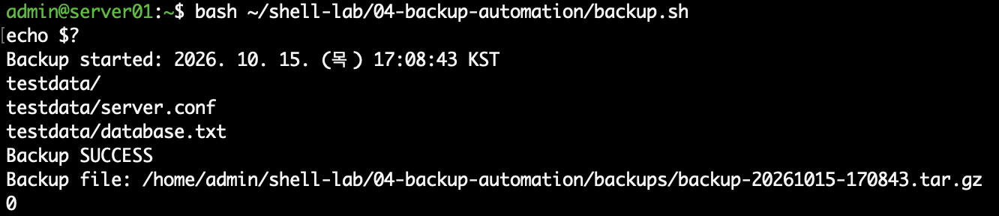
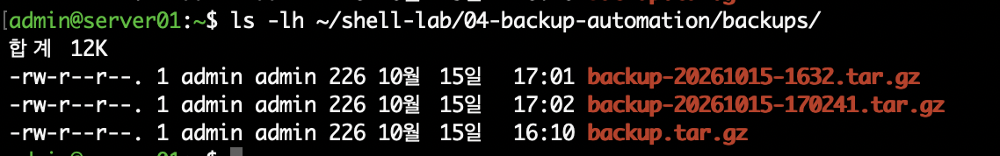
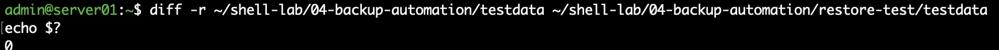

# 04. Linux 서버 백업 자동화 및 복구 검증

## 1. 실습 개요

Rocky Linux 환경에서 Bash Shell Script와 `tar` 명령어를 활용하여 파일 백업을 자동화하였다.

백업 실행 시 날짜와 시간이 포함된 압축 파일을 생성하고, 백업 파일을 별도 디렉터리에 복구한 후 원본과 비교하여 데이터 무결성을 검증하였다.

이번 실습의 목표는 단순한 압축 파일 생성이 아니라 **백업 생성, 정상 완료 여부 확인, 복구 검증**까지 수행하는 것이다.

## 2. 실습 환경

| 항목 | 내용 |
|---|---|
| 운영체제 | Rocky Linux 10.2 ARM64 |
| 가상화 | VMware Fusion |
| 호스트명 | server01.example.com |
| 사용 언어 | Bash |
| 백업 방식 | tar + gzip |
| 백업 대상 | testdata 디렉터리 |
| 백업 스크립트 | backup.sh |

## 3. 디렉터리 구성

```text
04-backup-automation/
├── backup.sh
├── testdata/
│   ├── server.conf
│   └── database.txt
├── backups/
│   └── backup-YYYYMMDD-HHMMSS.tar.gz
└── restore-test/
    └── testdata/
        ├── server.conf
        └── database.txt
```

`testdata`는 백업 대상이며, `backups`는 백업 파일 저장 위치이다.

`restore-test`는 원본 데이터를 변경하지 않고 복구를 검증하기 위한 별도 디렉터리이다.

## 4. 테스트 데이터 준비

```bash
mkdir -p ~/shell-lab/04-backup-automation/testdata

echo "Linux server configuration" > ~/shell-lab/04-backup-automation/testdata/server.conf

echo "Database backup test" > ~/shell-lab/04-backup-automation/testdata/database.txt
```

테스트 데이터를 준비한 뒤 `ls -l` 명령어로 파일 생성 여부를 확인하였다.

## 5. 백업 파일 생성

다음 명령어를 사용하여 `testdata` 디렉터리를 gzip 형식으로 압축하였다.

```bash
tar -czvf backup.tar.gz -C /home/admin/shell-lab/04-backup-automation testdata
```

| 옵션 | 설명 |
|---|---|
| `c` | 새로운 tar 아카이브 생성 |
| `z` | gzip 압축 사용 |
| `v` | 처리 파일 출력 |
| `f` | 생성할 파일 이름 지정 |
| `-C` | 압축 작업 기준 디렉터리 변경 |

`-C` 옵션을 사용하여 아카이브 내부에 불필요한 절대 경로가 포함되지 않도록 구성하였다.

### 백업 파일명 자동 생성

```bash
BACKUP_DATE=$(date +%Y%m%d-%H%M%S)
BACKUP_FILE="backup-${BACKUP_DATE}.tar.gz"
```

명령어 치환 `$()`를 사용하여 실행 시각을 가져오고, 변수 확장 `${}`을 활용하여 백업 파일명을 생성하였다.

스크립트에서는 초 단위까지 포함하여 같은 분에 실행하더라도 파일 이름이 중복될 가능성을 줄였다.

## 6. 백업 자동화 스크립트

백업 디렉터리 생성, 압축 파일 생성, 성공 및 실패 처리 과정을 Bash 스크립트로 구성하였다.

**소스코드:** [backup.sh](./backup.sh)

스크립트의 주요 처리 과정은 다음과 같다.

1. 백업 대상 경로 및 저장 경로 설정
2. 날짜와 시간이 포함된 파일명 생성
3. 백업 저장 디렉터리 준비
4. `tar` 명령어로 압축 백업 실행
5. 실행 성공 여부 확인
6. 백업 파일 경로와 결과 출력
7. 실패 시 종료 코드 `1` 반환

### 스크립트 실행

```bash
bash -n ~/shell-lab/04-backup-automation/backup.sh

bash ~/shell-lab/04-backup-automation/backup.sh

echo $?
```

정상 실행 시 `Backup SUCCESS`와 종료 코드 `0`을 확인하도록 구성하였다.



## 7. 백업 파일 생성 검증

다음 명령어로 실제 백업 파일이 생성되었는지 확인하였다.

```bash
ls -lh ~/shell-lab/04-backup-automation/backups/
```

백업 파일 내부 목록도 확인할 수 있다.

```bash
tar -tzvf /path/to/backup.tar.gz
```

백업 파일에는 `testdata/server.conf`와 `testdata/database.txt`가 포함된다.



## 8. 백업 복구 및 무결성 검증

### 복구 테스트

백업 파일을 원본과 다른 `restore-test` 디렉터리에 압축 해제하였다.

```bash
mkdir -p ~/shell-lab/04-backup-automation/restore-test

tar -xzvf /path/to/backup.tar.gz \
  -C ~/shell-lab/04-backup-automation/restore-test
```

위 명령어의 `/path/to/backup.tar.gz`는 실제 생성된 백업 파일의 경로로 변경해야 한다.

### 원본과 복구 파일 비교

```bash
diff -r \
  ~/shell-lab/04-backup-automation/testdata \
  ~/shell-lab/04-backup-automation/restore-test/testdata

echo $?
```

`diff`의 출력이 없고 종료 코드가 `0`이면 두 디렉터리의 파일 내용이 동일하다는 것을 의미한다.



## 9. 오류 처리

백업 작업이 실패했을 때 정상 완료 메시지가 출력되지 않도록 `if` 조건문을 활용하였다.

```bash
if tar -czvf "$BACKUP_PATH" -C "$SOURCE_DIR" testdata; then
    echo "Backup SUCCESS"
    echo "Backup file: $BACKUP_PATH"
else
    echo "Backup FAILED"
    exit 1
fi
```

`tar` 명령어가 성공하면 백업 성공 메시지를 출력하며, 실패할 경우 오류 메시지와 함께 종료 코드 `1`을 반환한다.

## 10. 학습 내용

- `tar`를 이용한 압축 및 해제
- `-C` 옵션을 활용한 상대 경로 기반 백업
- 날짜와 시간이 포함된 파일명 생성
- Bash 변수 선언과 변수 확장
- `$()` 명령어 치환
- `if` 조건문을 이용한 명령어 성공 여부 판단
- 종료 코드 `0`, `1`의 의미
- 원본과 복구 파일의 `diff` 비교
- 백업 결과 검증 및 문서화

## 11. 향후 개선 사항

- 일정 기간이 지난 백업 파일 자동 정리
- 백업 파일 체크섬 검증
- cron 기반 정기 백업
- 백업 실패 시 알림
- 별도 디스크 또는 원격 저장소로 백업 파일 전송

이번 실습을 통해 Linux 환경에서 기본적인 파일 백업 자동화와 복구 검증 과정을 경험하였다.
